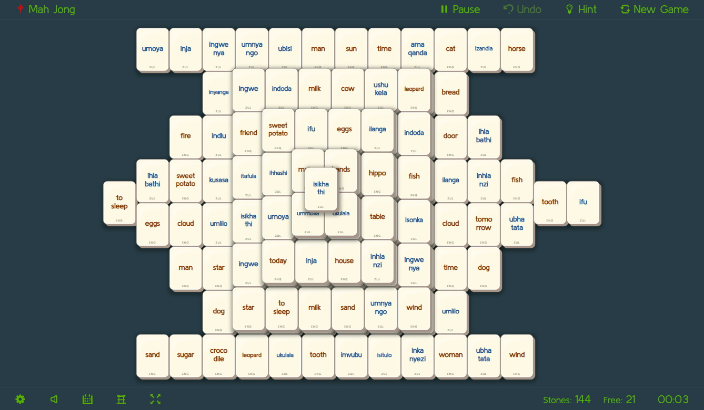

# MahZulu - Mahjong Solitaire Zulu Learning

Learn isiZulu vocabulary by playing Mahjong Solitaire! MahZulu is a fork of the open-source [Mah](https://github.com/ffalt/mah) Mahjong Solitaire game, reimagined as a language learning game.  
**Completely free. No ads. No tracking. No cloud.**

## 🀄 How to play

- Clear the board by matching tiles in pairs: one tile shows a **word in isiZulu**, its partner shows the **same word in English**.
- Each word appears on four tiles — two in Zulu and two in English — and you must always match **across the two languages**. Two Zulu tiles (or two English tiles) of the same word never pair up.
- Zulu tiles are shown in blue with a **ZUL** badge, English tiles in red-brown with an **ENG** badge, so you can tell them apart at a glance.
- Only free tiles can be picked: a tile is blocked while another tile lies on top of it, or while tiles touch it on both the left and right side.

The vocabulary contains **63 word pairs** across 9 categories: greetings, family, house & home, animals, nature, food, body, time and verbs.

[](http://opensource.org/licenses/MIT)

---

## ✨ Features

🎓 **Zulu ↔ English word matching** - the classic tile matching rule becomes a vocabulary drill: find the translation, not the twin

🧩 **84 built-in layouts** - from classic layouts like Turtle and Dragon to unique custom designs

🌱 **Random seed based layout generator** - enter or generate a custom seed to share or replay a specific randomly generated board for endless replayability

🔤 **63 word pairs on the tiles** - words are written directly on the tile faces, color-coded by language with a ZUL/ENG badge, in light and dark styles

🏆 **3 difficulty levels for features and boards generation** - from relaxed casual play to expert-level challenge

📅 **Daily challenge** - one board and one rule set per day, the same for everyone, with streaks, a result calendar and a best score per challenge type

🎯 **7 challenge types** - timed runs, score hunts and special tiles change how a board has to be cleared

🖼️ **Massive visual customization** - 8 image backgrounds, 375 pattern backgrounds, light/dark mode, 14 color themes, 3D tiles and shadows

🧘 **Zen mode** - hide the UI chrome for a clean, distraction-free playing experience

🔍 **Pan, zoom and rotate** - move and pinch-zoom the board, and optionally rotate it in portrait to fit wide layouts on a phone

⌨️ **Playable by keyboard** - tab and arrow key navigation everywhere, shortcuts for every game action, visible focus and screen reader announcements

⏱️ **Optional game timer** - show or hide the game clock to suit your play style

🎉 **Victory confetti** - optional celebratory confetti burst when you clear the board

💾 **Auto-save** - your game state and best times are saved locally in your browser, never to the cloud

📱 **Cross-platform** - runs in the browser, on desktop (macOS, Windows, Linux), and on Android

🌍 **40 interface languages** - English, العربية, বাংলা, Català, Čeština, Dansk, Deutsch, Ελληνικά, Español, Euskara, فارسی, Suomi, Filipino, Français, Gaeilge, हिन्दी, Magyar, Bahasa Indonesia, Íslenska, Italiano, 日本語, 한국어, Монгол, Bahasa Melayu, Nederlands, Norsk, Polski, Português, Română, Русский, Svenska, Kiswahili, தமிழ், తెలుగు, ไทย, Türkçe, Українська, اردو, Tiếng Việt, 中文

---

## 📅 Daily Challenge

One board and one rule set per day, the same for everyone. A new challenge unlocks at midnight, your local time.
Your streak, your best streak, a won/played count and a calendar of past results are kept locally, and each challenge type keeps its own best score.

| Challenge    | Objective                                                                                           |
|--------------|-----------------------------------------------------------------------------------------------------|
| Midas Match  | Find and match the gold-marked tile. Hints and undo are allowed.                                    |
| Sparkstone   | Clear the board before time runs out. Matching the sparkstone adds time and marks a new one.        |
| Match Rush   | Make the target number of matches before time runs out. The board does not have to be cleared.      |
| Fortune Hunt | Reach the target score before time runs out. Fast matches in a row build a multiplier.              |
| Running Sand | You start with little time. Every match adds time, but only up to a limit. Clear the board in time. |
| The Purge    | Remove every tile of the marked word category before time runs out.                                 |
| Blackout     | Only free tiles show their face, covered tiles stay blank. Hints are allowed, undo is not.          |

---

## 🏛️ Explore More Layouts

### [Mahjong Solitaire Layout Museum](https://ffalt.github.io/mahseum/)

Browse a curated archive of custom layouts created by the Kyodai Mahjongg community.
Click any layout and select **"Play it with Mah"** to import it directly into your game.

---

## 📷 Screenshot

<div align="center">
 
</div>

---

## 🙏 Acknowledgements

MahZulu is a fork of [Mah](https://github.com/ffalt/mah) by ffalt — the tile faces were replaced with Zulu and English words, everything else builds on the original engine.

Its art is built on open-source creative work. See the credits for [artwork](src/assets/svg/README.md), [backgrounds](src/assets/img/README.md), [sounds](src/assets/sounds/README.md), [icons](src/app/components/icons/README.md) and [fonts](src/fonts/README.md).

---

## 🐳 Docker

Build and run your own MahZulu container:

```bash
docker build -t mahzulu -f resources/docker/Dockerfile .
docker run -d -p 8080:80 mahzulu
```

Then open [http://localhost:8080](http://localhost:8080).

For more details, see [resources/docker](./resources/docker/README.md).

---

## 🛠️ Development

### Build Config

The default game name is "Mah Jong". To change it:

1. Copy `custom-build-config.json.dist` to `custom-build-config.json`
2. Edit the name in `custom-build-config.json` to your desired app name

### Quick Start

```bash
npm run start         # Dev server → http://localhost:4200/
npm run build:prod    # Production build → dist/
npm run test          # Run unit tests
```
